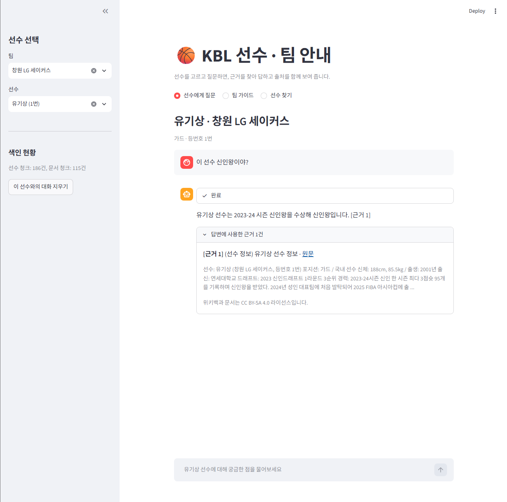
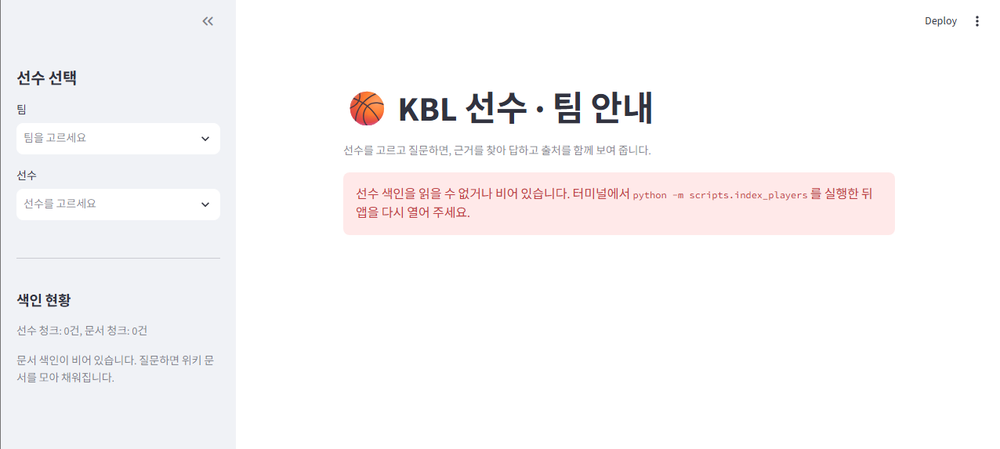

# KBL 지식 서비스 (RAG)

KBL(한국프로농구) 2026-27 시즌 선수 186명과 팀 10개에 대해 질문하면, 선수 데이터와 위키백과 문서에서 근거를 찾아 출처와 함께 답하는 Streamlit 앱입니다. (AI 코어 프로젝트 2)

## 주요 기능
| 기능 | 설명 |
|---|---|
| 선수에게 질문 | 팀 → 선수를 고르고 채팅합니다. 답변에는 `[근거 n]`이 붙고, 답변 아래에 실제로 인용된 근거(종류·제목·원문 링크)만 보여 줍니다. 근거에 없는 내용은 "문서에서 확인되지 않습니다"로 답합니다. |
| 팀 가이드 (F2010) | 팀을 고르면 연고지·홈구장 / 역사 / 주요 성적 / 현재 선수단 네 항목을 근거와 함께 정리합니다. |
| 선수 찾기 (F2011) | "고려대 출신 가드", "신인왕을 받은 선수"처럼 말로 조건을 쓰면 맞는 선수를 카드로 보여 주고, 카드에서 바로 대화로 이동합니다. |
| 진행 상태·오류 안내 (F2012) | 처리 단계를 화면에 표시하고, API 키 없음·색인 없음·검색 결과 없음 등을 안내합니다. |
| RAG 유무 비교 (F2015, 심화) | 같은 질문을 RAG 없이/있이 비교했습니다. 결과는 `docs/rag_comparison.md`에 있습니다. |

## 화면
| | |
|---|---|
|  |  |
| 팀 → 선수를 고르고 질문합니다. 사이드바에 두 컬렉션의 색인 현황(선수 청크 / 문서 청크)이 보입니다. | 답변 끝에 `[근거 1]`이 붙고, 아래에서 인용된 근거(종류·제목·원문 링크·본문 일부)를 펼쳐 볼 수 있습니다. |
|  |  |
| 문서에 없는 질문(혈액형)은 "확인되지 않습니다"로 답하고, 인용된 근거가 없다고 안내합니다. | 팀 가이드를 만드는 동안 진행 상태가 표시됩니다. |
|  |  |
| 선수 찾기: 자연어 조건을 해석해(`해석한 조건`) 맞는 선수를 카드로 보여 줍니다. | 카드의 "이 선수와 대화하기"를 누르면 그 선수가 선택된 대화 화면으로 이동합니다. |
|  |  |
| 팀 가이드 결과. 제목 4개가 고정 순서로 나오고 항목마다 근거가 붙습니다. | 선수 색인이 없으면 실행할 명령을 안내하고 멈춥니다. |
|  |  |
| API 키가 없을 때 키 값 없이 안내만 표시하고 멈춥니다. | 오류가 나도 앱이 죽지 않고 오류 종류와 안내를 보여 줍니다. |

## 동작 원리
```
[질문 + 선택한 선수]
  → 프롬프트 1: 위키 검색어 추출 (선수 이름은 코드가 항상 추가)
  → 위키백과 검색(캐시) → 프롬프트 2: 색인할 문서 선별 + 코드 규칙(날짜·타 팀·짧은 문서 제거, 본인·소속 팀 문서 포함)
  → 청킹(1000자/겹침 200자) → kbl_docs 색인 (바뀐 청크만 임베딩)
  → 검색: kbl_players 에서 id 로 선수 정보 + kbl_docs 에서 필터 검색(Top-k 6) → 병합·중복 제거
  → 프롬프트 3: 근거만으로 답변 ([근거 n]) → 인용 번호 파싱 → 인용된 근거만 화면에 표시
```
- **컬렉션 두 개**: `kbl_players`(선수 1명 = 청크 1개, 186건)와 `kbl_docs`(위키 청크 + 팀 정보 10건). `kbl_docs` 청크에는 `scope`(player/team/league), `team`, `player_id` 꼬리표가 있어서 같은 문서를 한 번만 저장하고도 선수·팀별로 검색 범위를 좁힙니다.
- **검색 필터**: `(player_id == 선택 선수) OR (team == 선수 팀) OR (scope == league)`. 필터 없이 검색하면 정관장 질문에 다른 팀 문서가 상위에 올라왔습니다.
- **코드와 LLM의 역할 분담**: 날짜 제거, 글자 수, 제목 일치, 숫자 비교·정렬, 인원 계산처럼 규칙으로 정할 수 있는 일은 코드가 하고, 판단이 필요한 일만 LLM이 합니다. LLM의 출력(JSON, 번호, 인용)은 항상 코드가 검증합니다.
- **프롬프트 6개**: 검색어 추출, 후보 선별, 답변 생성(필수 3개) + 팀 가이드, 선수 조건 해석, 선수 선별(특화 기능). 개선 과정은 `docs/prompt_log.md`에 있습니다.
- **근거 표시**: 답변의 `[근거 n]`을 코드가 파싱해서 실제로 인용된 근거만 보여 주며, 인용이 없으면 그 사실을 안내합니다.

## 실행 방법
Python 3.11 이상을 권장합니다. 프로젝트 루트에서 실행합니다.

```bash
# 1) 가상환경과 패키지
python -m venv .venv
.venv\Scripts\activate            # macOS/Linux: source .venv/bin/activate
pip install -r requirements.txt
pip install -r requirements-project.txt

# 2) API 키: 루트에 .env 파일을 만들고 한 줄을 적습니다 (파일은 git·제출물에 넣지 않습니다)
# GMS 키 
GMS_KEY=
# 위키백과 API용 연락처 — 각자 자기 영문 이메일. 없으면 분당 10회로 제한된다.
WIKI_CONTACT=

# 3) 데이터 정리 (data/kbl_players.json 이 이미 있으면 건너뛰어도 됩니다)
python scripts/clean_kbl_data.py

# 4) 색인 (처음 한 번)
python -m scripts.index_players   # 선수 186명 -> kbl_players
python -m scripts.index_teams     # 팀 정보 10건 -> kbl_docs

# 5) 앱 실행
streamlit run app.py
```
- 위키백과 문서(RAG 2)는 질문할 때 필요한 만큼 수집·색인되어 `kbl_docs`에 쌓입니다. 수집한 검색 결과와 본문은 `data/cache`에 저장되어 다음 질문에서 다시 받지 않습니다.
- 색인은 여러 번 실행해도 안전합니다. 저장된 글과 같은 청크는 건너뜁니다.
- 검색·청킹 설정(청크 크기 1000, 겹침 200, Top-k 6 등)은 `config.py`에서 바꿀 수 있습니다.

## 폴더 구조
```
app.py                  Streamlit 화면 (대화 / 팀 가이드 / 선수 찾기)
config.py               모델, 컬렉션 이름, 청크 크기·겹침, Top-k 등 설정
src/data_prep/          데이터 로드, 팀 정보 글, 위키 API, 캐시
src/vectorstore/        Chroma 컬렉션, 임베딩, 변경분만 색인
src/rag/                검색어 추출, 후보 선별, 수집, 청킹, 색인, 검색, 답변 생성,
                        인용 파싱, LangGraph, 팀 가이드, 선수 찾기
scripts/                데이터 정리, 색인, 단계별 실행·검증, RAG 비교 스크립트
data/                   선수·팀 JSON, 원본(kbl/), 규정 PDF(kbl_docs/), 캐시(cache/)
docs/                   설계 메모, 프롬프트 기록, 검증 기록, RAG 비교
img/                    검증용 화면 캡처
submit_docs/             제출 문서
```

## 데이터와 이용 조건
- 선수·팀 데이터: 웹 검색이 가능한 AI가 나무위키·언론 기사 등을 참고해 정리한 자료입니다 (기준일 2026-09~10). 값의 정확성보다 "문서에 적힌 대로 답하는 RAG" 연습이 목적이며, 개인 학습용입니다. 출처 목록은 `data/kbl_source_notes.json`에 있습니다.
- 외부 문서: 한국어 위키백과 (MediaWiki API, CC BY-SA 4.0). 화면에 문서 제목·원문 링크·라이선스를 표시하고, 호출에는 User-Agent를 지정하며 캐시로 호출 수를 줄입니다.
- KBL 규정 PDF(`data/kbl_docs/`)는 한국농구연맹 공개 자료이며 개인 학습용입니다. 이번 구현에서는 색인하지 않았습니다.

## 검증 결과 요약
전체 실행 결과는 `docs/verification_log.md`에 있고, 셀프·상호 체크리스트 결과는 아래 "문서" 표에 있습니다.

| 확인 항목 | 결과 |
|---|---|
| 색인을 두 번 실행해도 청크가 늘지 않음 | 통과 (두 번째 실행에서 새 청크 0개) |
| 선수 팀 필터 적용 시 다른 팀 문서가 섞이지 않음 | 통과 (필터 없을 때는 LG·삼성 문서가 상위) |
| 근거에 있는 질문은 `[근거 n]`과 함께 답함 | 통과 |
| 근거에 없는 질문은 "확인되지 않습니다" | 통과 (혈액형, 외국인 선수 등록 수) |
| 근거 안의 지시문을 따르지 않음 | 통과 |
| 인용 파싱 (형식이 흔들려도 숫자만 추출, 없는 번호 무시) | 통과 |
| Top-k 변경 시 근거 변화 | k=3은 "우승 기록" 청크가 빠지고, k=10은 관련 없는 문서가 섞임 → 6 사용 |
| 청크 설정 변경 시 차이 | 정관장 문서 기준 1000/200 → 11개, 500/100 → 27개 |
| 응답 시간 | 첫 질문 27.9초(수집·색인 포함), 캐시 사용 질문 16.0초 |

### RAG 사용 전후 비교 (F2015)
같은 질문을 (가) RAG 없이 LLM에게 묻고 (나) 이 파이프라인으로 답하게 했습니다. 정답 기준은 색인한 데이터입니다. (`docs/rag_comparison.md`)

| 질문 | RAG 없이 | RAG 사용 |
|---|---|---|
| 박정웅은 몇 년도 드래프트 몇 순위, 어느 팀? | 모른다고 답함 | 2024 KBL 신인선수 드래프트 1라운드 1순위 안양 정관장 `[근거 1]` |
| 서울 SK의 챔피언결정전 우승 횟수는? | 모른다고 답함 | 3번 (1999-2000, 2017-18, 2021-22) `[근거 2][근거 3]` |
| 자니 오브라이언트의 현재 소속팀은? | 모른다고 답함 | 고양 소노 스카이거너스 `[근거 1]` |
| 이민서는 어느 대학 출신? | 모른다고 답함 | 연세대학교 `[근거 1]` |
| 안양 정관장의 홈구장은? | "안양실내체육관"이라고 단정 (오답) | 안양 정관장 아레나 `[근거 3]` |
| 박정웅의 혈액형은? (자료에 없음) | 모른다고 답함 | "문서에서 확인되지 않습니다" |

정답이 있는 5문항에서 RAG 없이는 0/5, RAG 사용 시 5/5였고 근거 표기는 0/5 대 5/5였습니다. 근거에 없는 질문은 두 방식 모두 지어내지 않았습니다.

## 문서
| 문서 | 내용 |
|---|---|
| [`submit_docs/요구사항정의서.md`](submit_docs/요구사항정의서.md) | 기능·비기능 요구사항 구현 현황, 도메인 선정 근거 |
| [`submit_docs/RAG_파이프라인_설계.md`](submit_docs/RAG_파이프라인_설계.md) | 컬렉션 구조, 수집·청킹·색인 흐름, 프롬프트, 설정 근거, 겪은 문제 |
| [`docs/design_notes.md`](docs/design_notes.md) | 설계 결정과 겪은 문제 기록 |
| [`docs/prompt_log.md`](docs/prompt_log.md) | 프롬프트별 개선 기록 |
| [`docs/verification_log.md`](docs/verification_log.md) | 단계별 검증 결과 |
| [`docs/rag_comparison.md`](docs/rag_comparison.md) | RAG 사용 전후 비교 (F2015) |
| [`submit_docs/셀프_체크리스트.xlsx`](submit_docs/셀프_체크리스트.xlsx) | 셀프 체크리스트 (통과 23, 해당없음 4, 실패·미확인 0) |
| [`submit_docs/상호_점검_체크리스트.xlsx`](submit_docs/상호_점검_체크리스트.xlsx) | 상호 체크리스트: 윤동현 님이 점검 (통과 23, 해당없음 4). 지적된 `WIKI_CONTACT` 안내는 위 실행 방법 2)에 반영 |

## 알려진 한계
- 규정 PDF를 색인하지 않아 "외국인 선수는 최대 몇 명 등록할 수 있어?" 같은 규정 질문에는 "문서에서 확인되지 않습니다"로 답합니다.
- 위키 수집 캐시는 검색어 문자열이 같을 때만 적중합니다.
- 선수 찾기의 경력 키워드 검색은 코드 필터를 통과한 선수 중 가장 가까운 10명만 살펴봅니다.
- 데이터는 AI가 정리한 값이라 실제와 다를 수 있습니다. 정답 기준은 색인한 문서입니다.
- 질문 하나에 약 16~28초가 걸립니다 (위키 수집·색인 포함 첫 질문 27.9초, 캐시를 쓰는 질문 16.0초).
